# What is Docker?

Docker is a tool that packages an application **together with everything it needs to run** (code, runtime, libraries, config) into one portable unit called a **container**. That container runs the same way on your laptop, a teammate's laptop, a CI server and production.

## The problem it solves

Without Docker, "it works on my machine" is common: a different Node/Python version, a missing library, or a different OS breaks the app somewhere else. Docker fixes this by shipping the whole environment, not just the code.

## Three words to know

| Term | One-line meaning | Analogy |
|------|------------------|---------|
| **Image** | A read-only template with the app and its environment | A recipe / a class |
| **Container** | A running instance of an image | The cooked dish / an object |
| **Registry** | A place to store and share images (e.g. Docker Hub) | A recipe library / GitHub for images |

Read next: [Images](01_images.md) → [Containers](02_containers.md).

## Containers vs virtual machines

| | Container | Virtual machine |
|---|---|---|
| Shares the host OS kernel | ✅ Yes | ❌ No, runs its own full OS |
| Start-up time | Seconds or less | Minutes |
| Size | MBs | GBs |
| Isolation | Process-level (namespaces + cgroups) | Hardware-level (hypervisor) |

## How the pieces fit



- You type commands in the **Docker client** (`docker build`, `docker pull`, `docker run`).
- The client sends them over a REST API to the **Docker daemon** (`dockerd`) on the Docker host.
- The daemon builds and stores **images**, runs **containers**, and manages **volumes** and **networks**.
- Images are pushed to and pulled from a **registry** such as Docker Hub.

More detail: [Docker Daemon Architecture](../resources/02_docker_daemon.md).

## Your first container

```bash
docker --version          # is Docker installed?
docker run hello-world    # pull the image (if needed) and run it as a container
docker ps -a              # list containers, including stopped ones
```

`docker run` does three things: pulls the image if it isn't local, creates a container from it, and starts it.
