# Docker Images

An **image** is a read-only template that contains everything an app needs to run: a base OS layer, a runtime (Node, Python, Java…), dependencies and your code. You never run an image directly: you start **containers** from it.

## Images are made of layers



- Each instruction in a `Dockerfile` (`FROM`, `RUN`, `COPY`…) creates one **read-only layer**.
- Layers stack: base OS → runtime → dependencies → app code.
- Layers are **cached and shared**. If two images use `node:20-alpine`, that layer is stored once, and rebuilding only redoes the layers that changed.
- When a container starts, Docker adds a thin **writable layer** on top. That's the only place the running app can write.

**Tip:** put things that change rarely (installing dependencies) *before* things that change often (copying your source code) so the cache is reused.

## A tiny Dockerfile

```dockerfile
FROM node:20-alpine        # base + runtime layer
WORKDIR /app
COPY package*.json ./
RUN npm ci                 # dependencies layer (cached until package files change)
COPY . .                   # app code layer
CMD ["node", "server.js"]  # what runs when a container starts
```

## Everyday image commands

```bash
docker build -t myapp:1.0 .     # build an image from the Dockerfile in this folder
docker images                   # list local images
docker pull nginx:alpine        # download an image from a registry
docker tag myapp:1.0 user/myapp:1.0
docker push user/myapp:1.0      # upload to Docker Hub
docker rmi myapp:1.0            # remove an image
```

## Name and tag

`nginx:1.27-alpine` → repository `nginx`, tag `1.27-alpine`. With no tag, Docker uses `latest`.

See also: [Image Management Commands](../docker%20cmd/02_IMAGE_MANAGEMENT.md) · next: [Containers](02_containers.md)
