# Images & Containers: What and Why?

## 📌 Overview
**Image** एक read-only template (blueprint) है जिसमें code, runtime, libraries और setup instructions होते हैं।
An **image** is a read-only template (blueprint) that holds the code, runtime, libraries and setup instructions.

**Container** उसी image का एक running instance है: एक isolated process जो आपका app चलाता है।
A **container** is a running instance of that image: an isolated process that runs your app.

## 🧠 Analogy

| Image | Container |
|-------|-----------|
| Class / recipe | Object / cooked dish |
| Build once | Run many times |
| Read-only | Adds a thin writable layer |

एक image से कई containers बन सकते हैं, और हर container दूसरे से isolated रहता है।
One image can start many containers, and each container is isolated from the others.

## ❓ Why?
- Image share करना आसान है: पूरा environment एक package में।
  Images are easy to share: the whole environment is in one package.
- Container हर machine पर same तरीके से चलता है।
  A container runs the same way on every machine.

