# Understanding Image Layers

## 📌 Overview
Dockerfile की **हर instruction एक layer** बनाती है। Docker हर layer को **cache** करता है।
**Every Dockerfile instruction creates a layer**, and Docker **caches** each layer.



## ⚙️ Cache कैसे काम करता है
- Rebuild पर, अगर instruction और उसकी files नहीं बदलीं, तो Docker cached layer use करता है (`CACHED` दिखता है)।
  On rebuild, if an instruction and its files haven't changed, Docker reuses the cached layer (you see `CACHED`).
- जैसे ही **एक layer बदलती है, उसके बाद की सभी layers** दोबारा बनती हैं।
  As soon as **one layer changes, every layer after it** is rebuilt.

## ❌ Slow order
```dockerfile
COPY . /app          # any code change invalidates this layer…
RUN npm install      # …so npm install runs again every time
```

## ✅ Fast order
```dockerfile
COPY package.json /app
RUN npm install      # cached until package.json changes
COPY . /app          # only this layer rebuilds on code changes
```

## 💡 Key takeaway
कम बदलने वाली चीज़ें ऊपर, ज़्यादा बदलने वाली नीचे।
Put things that change rarely at the top and things that change often at the bottom.

Running container image layers के ऊपर एक पतली **writable layer** जोड़ता है।
A running container adds a thin **writable layer** on top of the image layers.
