# Sharing Images: Overview

## 📌 Overview
Image का पूरा फ़ायदा तब है जब उसे दूसरे लोग या servers use कर सकें। Share करने के दो तरीके हैं:
An image is most useful when other people or servers can run it. There are two ways to share:

| Option | Hindi | English |
|--------|-------|---------|
| **Dockerfile + source code** share करें | दूसरा व्यक्ति खुद `docker build` करता है | The other person runs `docker build` themselves |
| **Built image** share करें | बना हुआ image सीधे download करके चलाएँ: कोई build step नहीं | They download the finished image and run it: no build step |

Production servers के लिए दूसरा तरीका (built image) आम है।
The second option (built image) is the norm for production servers.

## 🏪 Registries
- **Docker Hub**: public और private repositories, free tier के साथ।
  **Docker Hub**: public and private repositories, with a free tier.
- **Private registries**: AWS ECR, GitHub Container Registry, Azure ACR, या self-hosted।
  **Private registries**: AWS ECR, GitHub Container Registry, Azure ACR, or self-hosted.

Next: [Pushing Images to Docker Hub](38_pushing-to-docker-hub.md)
