# Volumes & Bind Mounts: Summary

## 📊 Comparison
| | Anonymous volume | Named volume | Bind mount |
|--|------------------|--------------|------------|
| Syntax | `-v /app/data` | `-v data:/app/data` | `-v /abs/host/path:/app/data` |
| Host location | Docker manages | Docker manages | **आप चुनते हो / You choose** |
| Container हटने पर / On container removal | `--rm` से delete / Deleted with `--rm` | ✅ बचा रहता है / Survives | ✅ Host पर है / On the host |
| Containers के बीच share / Shared across containers | ❌ | ✅ | ✅ |
| Host से edit / Edit from host | ❌ | ❌ | ✅ |
| Dockerfile में? / In a Dockerfile? | ✅ `VOLUME` | ❌ | ❌ |
| Typical use | Protect a sub-folder (`node_modules`) | Persistent app data | Live source code (dev) |

## 🧾 Key points
- Anonymous volume एक container से बँधा होता है; किसी sub-folder को bind mount से "बचाने" में काम आता है।
  An anonymous volume is tied to one container; useful to "protect" a sub-folder from a bind mount.
- Named volume को `run` के समय `-v name:path` से ही बना सकते हैं (या `docker volume create`)।
  A named volume is created with `-v name:path` at `run` time (or `docker volume create`).
- Bind mount का data पूरी तरह आपके host folder में है; Docker उसे delete नहीं करता।
  Bind-mount data lives entirely in your host folder; Docker never deletes it.

## 💡 Key takeaway
- Data जिसे आप देखना/edit करना चाहते हो → bind mount; बाकी permanent data → named volume।
  Data you want to see/edit → bind mount; other permanent data → named volume.
