# How Docker Resolves IP Addresses

## 📌 Overview

Docker आपका source code **नहीं बदलता**। `mongodb://mongodb:27017` code में वैसा ही रहता है।
Docker does **not** rewrite your source code. `mongodb://mongodb:27017` stays exactly as written.

जब app request भेजता है, तब container का DNS lookup Docker के embedded DNS server (`127.0.0.11`) से होता है, जो name को सही IP में बदल देता है।
When the app sends a request, the container's DNS lookup goes to Docker's embedded DNS server (`127.0.0.11`), which resolves the name to the right IP.



## 🔍 क्या resolve होता है? / What gets resolved
| Name | Resolves to | Hindi |
|------|-------------|-------|
| `mongodb` (container name) | That container's IP on the shared network | उसी network पर उस container का IP |
| `host.docker.internal` | The host machine's IP | Host machine का IP |
| `swapi.dev` | Public IP via the host's upstream DNS | Host के DNS से public IP |

## ⚙️ खुद देखें / See it yourself
```bash
docker exec favorites cat /etc/resolv.conf    # nameserver 127.0.0.11
docker exec favorites getent hosts mongodb    # 172.18.0.2  mongodb
```

## ⚠️ ध्यान दें / Note
Resolution request के समय होता है, इसलिए container recreate होकर नया IP मिले तब भी name काम करता रहता है।
Resolution happens at request time, so the name keeps working even if a recreated container gets a new IP.

## 💡 Key takeaway
Code में names लिखो, IPs नहीं; Docker का DNS बाकी संभाल लेता है।
Write names in code, not IPs; Docker's DNS handles the rest.
