# Docker Network Drivers

## 📌 Overview

हर network एक **driver** से बनता है जो तय करता है कि traffic कैसे चलेगा। Default driver `bridge` है।
Every network uses a **driver** that decides how traffic flows. The default driver is `bridge`.



| Driver | Hindi | English |
|--------|-------|---------|
| `bridge` | Default; एक host पर isolated network, name से DNS (user-defined में) | Default; isolated network on one host, DNS by name (user-defined) |
| `host` | Container host का network सीधे use करता है, कोई isolation नहीं (`-p` ignore) | Container shares the host's network stack, no isolation (`-p` ignored) |
| `none` | कोई network नहीं, पूरी तरह isolated | No networking at all, fully isolated |
| `overlay` | कई Docker hosts को जोड़ता है (Swarm) | Connects containers across multiple Docker hosts (Swarm) |
| `macvlan` | Container को अपना MAC address, LAN पर physical device जैसा दिखता है | Gives a container its own MAC; looks like a physical device on the LAN |
| Third-party plugins | Special needs के लिए extra drivers (जैसे Weave, Calico) | Extra drivers for special needs (e.g. Weave, Calico) |

## ⚙️ Commands
```bash
docker network create --driver bridge favorites-net   # same as the default
docker network create -d overlay my-overlay           # needs Swarm mode
docker run --network host nginx                       # host networking
docker run --network none alpine                      # no network
docker network inspect favorites-net
```

## ⚠️ ध्यान दें / Note
- `host` driver पूरी तरह सिर्फ Linux पर काम करता है; Docker Desktop पर behaviour अलग हो सकता है।
  The `host` driver fully works only on Linux; Docker Desktop may behave differently.
- ज़्यादातर single-host apps के लिए user-defined `bridge` ही काफी है।
  For most single-host apps, a user-defined `bridge` is all you need.

## 💡 Key takeaway
Default `bridge` से शुरू करो; बाकी drivers खास cases के लिए हैं।
Start with `bridge`; the other drivers are for special cases.
