# Module Summary: Networking

## 📌 Recap

| Case | Hindi | Solution |
|------|-------|----------|
| Container → WWW | Out of the box काम करता है | Nothing to do |
| Container → Host | `localhost` container खुद है | `host.docker.internal` (+ `--add-host=host.docker.internal:host-gateway` on Linux) |
| Container → Container | दोनों को एक network में रखो | `docker network create` + `--network` + container name as hostname |



## ⚙️ Cheat-sheet
```bash
docker network create favorites-net
docker network ls
docker network inspect favorites-net
docker run -d --name mongodb --network favorites-net mongo
docker run -d --rm -p 3000:3000 --network favorites-net favorites-node
docker container inspect -f '{{.NetworkSettings.IPAddress}}' mongodb
docker network rm favorites-net
```

## 🧠 Practice (Quiz 4: Docker Container Communication & Networks)
1. Container के अंदर `localhost` किसे point करता है? / What does `localhost` point to inside a container?
2. Container से host पर चल रही MongoDB तक कैसे पहुँचें? Linux पर क्या extra चाहिए? / How do you reach MongoDB on the host from a container, and what extra is needed on Linux?
3. Container IP hard-code करना fragile क्यों है? / Why is hard-coding a container IP fragile?
4. Container name को hostname की तरह use करने के लिए क्या ज़रूरी है? / What is required to use a container name as a hostname?
5. क्या `docker run --network xyz` network को auto-create करता है? / Does `docker run --network xyz` create the network for you?
6. Container ↔ container communication के लिए `-p` चाहिए? / Is `-p` needed for container ↔ container communication?
7. क्या Docker आपके source code में names को IPs से replace करता है? / Does Docker replace names with IPs in your source code?
8. `bridge`, `host`, `none`, `overlay` drivers में क्या फर्क है? / What is the difference between the `bridge`, `host`, `none` and `overlay` drivers?

## 🔗 Module resources
- [Docker networking overview](https://docs.docker.com/engine/network/)
- [Network drivers](https://docs.docker.com/engine/network/drivers/)
- [Connect from a container to a service on the host (`host.docker.internal`)](https://docs.docker.com/desktop/features/networking/#i-want-to-connect-from-a-container-to-a-service-on-the-host)
- See also: [Docker networking commands](../docker%20cmd/03_NETWORKING.md)

## 💡 Key takeaway
WWW free है, host के लिए `host.docker.internal`, और containers के बीच Docker network + names।
WWW is free, use `host.docker.internal` for the host, and a Docker network + names between containers.
