# Docker Networks for Cross-Container Communication

## 📌 Overview

`host.docker.internal` से host के through जाने की जगह, हम containers को एक shared network में डालते हैं।
Instead of going through the host with `host.docker.internal`, we put containers on a shared network.

एक user-defined network में containers एक-दूसरे को **container name** से reach कर सकते हैं।
On a user-defined network, containers reach each other by **container name**.



## ⚙️ Commands
```bash
docker network create goals-net

# MongoDB: अब -p की ज़रूरत नहीं / no -p needed anymore
docker run --name mongodb --rm -d --network goals-net mongo

# Backend: same network, port 80 अब भी published (browser के लिए)
docker build -t goals-node .
docker run --name goals-backend --rm -d -p 80:80 --network goals-net goals-node

# Frontend: network की ज़रूरत नहीं / no network needed
docker run --name goals-frontend --rm -p 3000:3000 -it goals-react
```

## 🔌 Backend connection string
```js
mongoose.connect('mongodb://mongodb:27017/course-goals');   // host = container name
```

Code बदला है, इसलिए backend image फिर से build करनी होगी।
The code changed, so the backend image must be rebuilt.

## 🤔 किसे network चाहिए? / Who needs the network?

| Container | Network? | क्यों / Why |
|-----------|----------|-------------|
| mongodb | ✅ | Backend उसे name से reach करता है / The backend reaches it by name |
| goals-backend | ✅ | Mongo से बात करता है / Talks to Mongo |
| goals-frontend | ❌ | Requests browser से जाती हैं, container से नहीं / Requests come from the browser, not the container |

Mongo का port अब host पर publish नहीं है, सिर्फ़ network के अंदर accessible है (ज़्यादा secure)।
Mongo's port is no longer published on the host; it is reachable only inside the network (more secure).

## 💡 Key takeaway
Container-to-container बात करने के लिए network + container name use करो; `-p` सिर्फ़ उसी के लिए जिसे host/browser से reach करना है।
Use a network + container name for container-to-container traffic; publish `-p` only for what the host/browser must reach.
