# Module Summary: Multi-Container Apps

## 📌 Recap

हमने goals app को तीन containers में चलाया, जो network, volumes और env vars से जुड़े हैं।
We ran the goals app as three containers wired together with a network, volumes and env vars.



## ⚙️ Cheat-sheet
```bash
docker network create goals-net

# MongoDB
docker run --name mongodb --rm -d --network goals-net \
  -v data:/data/db \
  -e MONGO_INITDB_ROOT_USERNAME=max -e MONGO_INITDB_ROOT_PASSWORD=secret \
  mongo

# Backend
docker build -t goals-node ./backend
docker run --name goals-backend --rm -d -p 80:80 --network goals-net \
  -v logs:/app/logs -v "$(pwd)/backend:/app" -v /app/node_modules \
  -e MONGODB_USERNAME=max -e MONGODB_PASSWORD=secret \
  goals-node

# Frontend
docker build -t goals-react ./frontend
docker run --name goals-frontend --rm -p 3000:3000 -it \
  -v "$(pwd)/frontend/src:/app/src" \
  goals-react
```

| Container | Network | Published port | Volumes |
|-----------|---------|----------------|---------|
| mongodb | goals-net | — | `data` (named) |
| goals-backend | goals-net | 80 | `logs`, bind mount, `node_modules` |
| goals-frontend | — | 3000 | bind mount `src` |

## ⚠️ यह development setup है / This is a dev setup
- Bind mounts, nodemon और React dev server सिर्फ़ development के लिए हैं; production में code image में होता है और React का optimized build serve होता है।
  Bind mounts, nodemon and the React dev server are for development only; in production the code lives in the image and an optimized React build is served.
- Credentials Dockerfile में hard-code करना production के लिए ठीक नहीं।
  Hard-coding credentials in a Dockerfile is not fine for production.

## 🚀 आगे क्या? / What's next
ये लंबे `docker run` commands याद रखना और हर बार type करना मुश्किल है; इसी problem को **Docker Compose** solve करता है।
These long `docker run` commands are hard to remember and retype; **Docker Compose** solves exactly this.

## 🔗 Module resources
- [mongo image on Docker Hub](https://hub.docker.com/_/mongo)
- [Docker networking overview](https://docs.docker.com/engine/network/)
- [Docker volumes](https://docs.docker.com/engine/storage/volumes/)
- [Docker bind mounts](https://docs.docker.com/engine/storage/bind-mounts/)

## 🧠 Practice
1. Container के अंदर `localhost` किसको point करता है, और backend Mongo से `localhost` से क्यों नहीं जुड़ पाता?
   What does `localhost` point to inside a container, and why can't the backend reach Mongo via `localhost`?
2. Frontend container को `goals-net` network की ज़रूरत क्यों नहीं है?
   Why doesn't the frontend container need the `goals-net` network?
3. Mongo से `-p 27017:27017` हटाने का क्या फ़ायदा है?
   What is the benefit of removing `-p 27017:27017` from Mongo?
4. Root user से connect करते समय `?authSource=admin` क्यों चाहिए?
   Why is `?authSource=admin` needed when connecting as the root user?
5. `-v /app/node_modules` (anonymous volume) न दें तो क्या होगा?
   What happens if you omit the `-v /app/node_modules` anonymous volume?
6. WSL पर React live reload काम न करे तो कौन से दो fixes हैं?
   Which two fixes help when React live reload doesn't work on WSL?
