# Module Summary: Docker Compose

## 📌 Recap

Docker Compose पूरे multi-container setup को एक `compose.yaml` में describe करता है और एक command से चलाता है।
Docker Compose describes a whole multi-container setup in one `compose.yaml` and runs it with one command.



## ⚙️ Full goals app
```yaml
services:
  mongodb:
    image: mongo
    volumes:
      - data:/data/db
    env_file:
      - ./env/mongo.env
  backend:
    build: ./backend
    ports:
      - "80:80"
    volumes:
      - logs:/app/logs
      - ./backend:/app
      - /app/node_modules
    env_file:
      - ./env/backend.env
    depends_on:
      - mongodb
  frontend:
    build: ./frontend
    ports:
      - "3000:3000"
    volumes:
      - ./frontend/src:/app/src
    stdin_open: true
    tty: true
    depends_on:
      - backend

volumes:
  data:
  logs:
```

## 📋 Cheat-sheet
| Command | Hindi | English |
|---------|-------|---------|
| `docker compose up -d` | सब कुछ background में start | Start everything in the background |
| `docker compose up --build -d` | Images rebuild करके start | Rebuild images, then start |
| `docker compose build` | सिर्फ images build | Build images only |
| `docker compose ps` / `logs -f` | Status / logs देखना | Show status / follow logs |
| `docker compose down` | Containers + network हटाना | Remove containers + network |
| `docker compose down -v` | Volumes भी delete | Also delete volumes |

## 🧠 Practice
1. Compose कौन सी समस्या solve करता है, और क्या ये Dockerfile की जगह लेता है? / What problem does Compose solve, and does it replace Dockerfiles?
2. Named volume के लिए top-level `volumes:` क्यों ज़रूरी है? / Why must a named volume be declared under top-level `volumes:`?
3. `environment` और `env_file` में क्या फ़र्क है? / What is the difference between `environment` and `env_file`?
4. Backend MongoDB तक किस hostname से पहुँचता है, और क्यों? / Which hostname does the backend use to reach MongoDB, and why?
5. `depends_on` क्या guarantee करता है और क्या नहीं? / What does `depends_on` guarantee, and what not?
6. `docker compose down` और `down -v` में क्या फ़र्क है? / What is the difference between `down` and `down -v`?
7. Frontend service को `stdin_open` और `tty` क्यों चाहिए? / Why does the frontend need `stdin_open` and `tty`?
8. Dockerfile बदलने के बाद नई image कैसे पक्का करें? / How do you make sure a new image is used after a Dockerfile change?
9. Folder `goals` में `backend` service का container name क्या होगा? / What container name does the `backend` service get in folder `goals`?

## 🔗 Module resources
- [Docker Compose overview](https://docs.docker.com/compose/)
- [Compose file reference](https://docs.docker.com/reference/compose-file/)
- [Compose CLI reference (`docker compose`)](https://docs.docker.com/reference/cli/docker/compose/)
- [Install the Compose plugin on Linux](https://docs.docker.com/compose/install/linux/)

See also: [Compose problem solved](../resources/08_compose_problem_solved.md) · [Compose internal architecture](../resources/09_compose_internal_architecture.md) · [Compose network internals](../resources/10_docker_compose_network_internals.md)

## 💡 Key takeaway
एक YAML file + `up` / `down` = पूरा app reproducible तरीके से चलाना।
One YAML file + `up` / `down` = running the whole app reproducibly.
