# Docker Compose: What & Why?

## 📌 Overview

Multi-container app को हाथ से चलाने के लिए network बनाना, volumes बनाना और हर container के लिए लंबी `docker run` command लिखनी पड़ती है।
Running a multi-container app by hand means creating a network, creating volumes and typing a long `docker run` command for every container.

Docker Compose ये सारी configuration एक file में रखता है, और `docker compose up` / `docker compose down` से पूरा setup चलता या रुकता है।
Docker Compose keeps all that configuration in one file, and `docker compose up` / `docker compose down` starts or stops the whole setup.



## ⚙️ Without Compose (previous section)
```bash
docker network create goals-net
docker run --name mongodb -v data:/data/db --env-file ./env/mongo.env --network goals-net -d mongo
docker build -t goals-node ./backend
docker run --name goals-backend -v logs:/app/logs -v "$(pwd)/backend:/app" -v /app/node_modules \
  --env-file ./env/backend.env --network goals-net -p 80:80 -d --rm goals-node
docker build -t goals-react ./frontend
docker run --name goals-frontend -v "$(pwd)/frontend/src:/app/src" -p 3000:3000 -it -d --rm goals-react
```

## ⚙️ With Compose
```bash
docker compose up -d     # everything above, in one command
docker compose down      # stop and remove it all again
```

## ⚠️ Compose क्या नहीं है / What Compose is not
- Compose Dockerfiles की जगह **नहीं** लेता; custom images अब भी Dockerfile से build होती हैं।
  Compose does **not** replace Dockerfiles; custom images are still built from a Dockerfile.
- Compose images या containers की जगह नहीं लेता; ये बस उन्हें manage करने का आसान तरीका है।
  Compose does not replace images or containers; it is just an easier way to manage them.
- Compose कई hosts (servers) पर containers manage करने के लिए नहीं है; ये एक host के लिए है।
  Compose is not for managing containers across multiple hosts; it targets a single host.

## 💡 Key takeaway
Compose = लंबी commands को एक declarative YAML file में बदलना।
Compose = turning long commands into one declarative YAML file.

See also: [Compose problem solved](../resources/08_compose_problem_solved.md)
