# Docker Compose Up & Down

## 📌 Overview

`compose.yaml` वाले folder में `docker compose up` सारे services start करता है: network, volumes, images (pull/build) और containers।
In the folder with `compose.yaml`, `docker compose up` starts all services: network, volumes, images (pull/build) and containers.

`docker compose down` containers और default network हटा देता है, लेकिन named volumes रहते हैं।
`docker compose down` removes the containers and the default network, but named volumes stay.



## ⚙️ Commands
```bash
docker compose up          # attached: logs of all services in this terminal
docker compose up -d       # detached: runs in the background
docker compose ps          # list this project's containers
docker compose logs -f     # follow logs (add a service name to filter)
docker compose down        # stop + remove containers and network
docker compose down -v     # also delete volumes (data is lost!)
```

## ⚠️ Watch out
- `down -v` named volumes भी delete करता है, यानी MongoDB का data चला जाएगा।
  `down -v` also deletes named volumes, so the MongoDB data is gone.
- Attached mode में `Ctrl+C` containers को stop करता है, remove नहीं; हटाने के लिए `down` चलाएँ।
  In attached mode `Ctrl+C` stops the containers but does not remove them; run `down` to remove them.

## 💡 Key takeaway
`up -d` से start, `down` से साफ़ shutdown; data delete करना हो तभी `-v`।
Start with `up -d`, clean shutdown with `down`; add `-v` only when you want to delete data.

See also: [Compose internal architecture](../resources/09_compose_internal_architecture.md)
