# Docker Architecture Overview

The big picture: who talks to whom when you use Docker.

## What it shows

- **Docker client**: the `docker` CLI where you type `docker build`, `docker pull`, `docker run`.
- **REST API**: the client doesn't do the work itself. It sends each command to the daemon.
- **Docker host / daemon**: the background service that actually builds images and runs containers. It manages four things:
  - **Images**: a base OS layer plus read-only app layers.
  - **Containers**: an image plus a writable layer, running as an isolated process.
  - **Volumes**: persistent storage that outlives containers.
  - **Networks**: how containers talk to each other and the outside world.
- **Registry** (Docker Hub or a private one): stores and distributes images via push/pull.

## Key takeaway

The CLI is only a remote control. The **daemon** does the real work, and the **registry** is how images move between machines.
