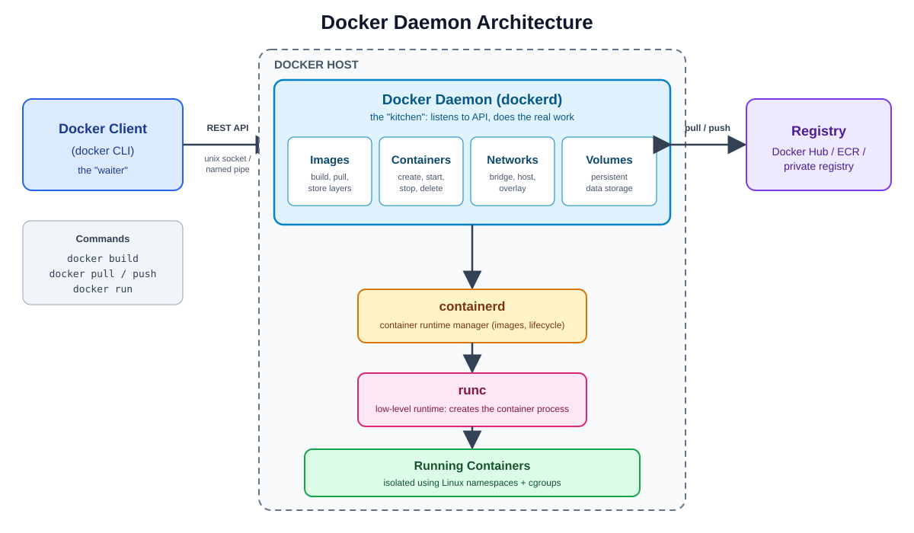

# Docker Daemon Architecture

What happens *inside* the Docker host after you press Enter.

## What it shows

- **Docker client (the "waiter")** takes your order (`docker build`, `pull`/`push`, `run`) and sends it over the **REST API**, through a Unix socket on Linux (`/var/run/docker.sock`) or a named pipe on Windows.
- **Docker daemon, `dockerd` (the "kitchen")** listens to the API and manages images, containers, networks and volumes.
- **containerd** is the container runtime manager. It handles image storage and the container lifecycle (create, start, stop).
- **runc** is the low-level runtime that actually creates the container process.
- **Running containers** are isolated with Linux **namespaces** (what a process can see) and **cgroups** (how much it can use).
- The daemon pulls and pushes images from a **registry** (Docker Hub, AWS ECR, a private registry).

## Key takeaway

`docker` → `dockerd` → `containerd` → `runc` → your process. Each layer has one job, and that is why Kubernetes can use containerd without `dockerd` at all.
