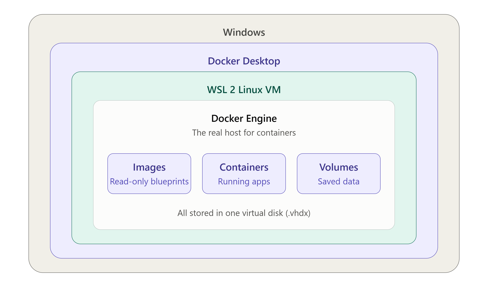

# Docker on Windows (WSL 2)

Containers need a Linux kernel, so how does Docker run on Windows?

## What it shows

- **Windows** is the outer layer: your normal OS.
- **Docker Desktop** is the app you install. It provides the GUI, the `docker` CLI and settings.
- **WSL 2 Linux VM**: Docker Desktop starts a lightweight Linux virtual machine through the Windows Subsystem for Linux.
- **Docker Engine** runs *inside* that VM. It is the real host for your containers.
  - **Images**: read-only blueprints.
  - **Containers**: running apps.
  - **Volumes**: saved data.
- Everything is stored in **one virtual disk file (`.vhdx`)**, which is why you free space by pruning in Docker (`docker system prune`), not by deleting files in Explorer.

## Key takeaway

On Windows your containers are Linux processes inside a WSL 2 VM. If the `docker` CLI can't connect, Docker Desktop (and its VM) usually isn't running.
