# Docker Pipeline Flow

The journey of an app from your editor to production.

## What it shows

1. **Dev**: write code plus a `Dockerfile` on your machine.
2. **Build**: `docker build` turns it into an **image**.
3. **Share**: `docker push` uploads the image to a registry (e.g. Docker Hub).
4. **Deploy**: a server or CI job runs `docker pull` to download that exact image.
5. **Run**: `docker run` starts a live container in production.

## Key takeaway

The **same image** runs identically in dev, staging and production. That is how Docker solves the "works on my machine" problem.
