# Docker Image Layers

Why images are built in layers, and why that makes builds fast.

## What it shows

From bottom to top:

- **Base OS layer**: Ubuntu / Alpine / Debian (read-only).
- **Runtime layer**: Node / Python / Java (read-only).
- **Dependencies layer**: npm / pip / apt packages (read-only).
- **App code layer**: your application files (read-only).
- **Container layer (writable)**: added only when a container starts. Your app writes here at runtime.

Each layer comes from **one Dockerfile instruction** (`FROM`, `RUN`, `COPY`…).

## Key takeaway

Layers are cached and shared between images. Order your Dockerfile from "changes least" to "changes most" so a code change rebuilds only the top layer. More: [Docker Images](../00_docker-basics/01_images.md).
