# Docker Network Types

The five network drivers and when to use each.

## What it shows

- **Bridge** *(default, most common)*: containers on the same bridge talk to each other **by name** and are isolated from the host. Outside traffic reaches them only through a published port (`-p 8080:80`).
- **Host** *(best performance)*: the container shares the host's network directly. There is no NAT, and no port mapping is needed.
- **None**: no networking at all. Useful for security sandboxing.
- **Overlay** *(multi-host clusters)*: connects containers on different machines (Swarm / Kubernetes) through an encrypted tunnel.
- **Macvlan**: gives a container its own MAC/IP on your LAN, so it looks like a real device.

## Key takeaway

Use a user-defined **bridge** for most apps, **host** when you need raw speed, and **overlay** when containers span several machines. Commands: [Networking Commands](../docker%20cmd/03_NETWORKING.md).
