# Problems Docker Compose Solves

Why Compose exists: running a real app takes more than one container.

## What it shows

**Without Compose:** a web app, an API, Postgres and Redis need **four long `docker run` commands**, each with its own ports, env vars, volumes and `--network`. It's easy to forget a flag, nothing controls start-up order, and networking is manual.

**With Compose:** one `docker-compose.yml` describes all four services (ports, env vars, volumes, dependencies, networks), and **`docker compose up`** starts everything with one command.

## Key takeaway

Compose turns your environment into a file you can commit, review and share. Start or stop the whole stack with one command.
