# Docker Compose Internal Architecture

What actually happens when you run `docker compose up`.

## What it shows

1. **`docker-compose.yml`**: you write this file.
2. **Compose CLI**: parses the YAML and works out dependencies between services.
3. It makes **REST API calls** to the **Docker Engine (`dockerd`)**, which executes everything.
4. The engine creates resources **in order**:
   - a **network** (`myapp_default`, bridge driver, built-in DNS),
   - **named volumes** (created first, so data persists),
   - **images** (pulled from a registry or built from a Dockerfile),
   - **containers**, started in `depends_on` order.
5. Result: a running application stack where all containers share one network and are reachable **by service name**.

## Key takeaway

Compose isn't a separate runtime. It is a planner that turns your YAML into ordinary Docker API calls.
