# Docker Compose Network Internals

How services in one Compose project find and talk to each other.

## What it shows

- Compose auto-creates a bridge network, `myapp_default`, with a **built-in DNS resolver**.
- Four services sit on it: **web** (nginx/React), **api** (Node/Django/Flask), **db** (Postgres/MySQL) and **cache** (Redis).
- They call each other **by service name**: `http://api`, `db:5432`, `cache:6379`. Docker's DNS maps `db` to the db container's internal IP automatically.
- Only **web** is published to the host (`ports: 3000:80`), so your browser reaches it at `localhost:3000`. `api`, `db` and `cache` are **not exposed** to the host.
- **db** keeps its data in the `db_data` volume, so it persists across restarts.

## Key takeaway

Never hard-code container IPs. Use service names, and publish only the ports the outside world needs.
