# Visual Architecture Guides

Each diagram has its own page with a short explanation. A suggested reading order:

| # | Diagram | What you learn |
|---|---------|----------------|
| 1 | [Docker Architecture Overview](01_docker_architecture_overview.md) | Client, daemon, images, containers, registry |
| 2 | [Docker Daemon Architecture](02_docker_daemon.md) | What `dockerd`, `containerd` and `runc` each do |
| 3 | [Docker on Windows](03_docker_on_windows_structure.md) | How Docker Desktop runs Linux containers via WSL 2 |
| 4 | [Docker Pipeline Flow](04_docker_pipeline_flow.md) | Build → push → pull → run |
| 5 | [Docker Image Layers](05_docker_image_layers.md) | Why images are layered and cached |
| 6 | [Docker Network Types](06_docker_network_types.md) | bridge, host, none, overlay, macvlan |
| 7 | [Docker Volume Types](07_docker_volume_types.md) | Named volumes, bind mounts, tmpfs |
| 8 | [Problems Compose Solves](08_compose_problem_solved.md) | Many `docker run` commands → one file |
| 9 | [Compose Internal Architecture](09_compose_internal_architecture.md) | What happens on `docker compose up` |
| 10 | [Compose Network Internals](10_docker_compose_network_internals.md) | Services talking by name over DNS |
